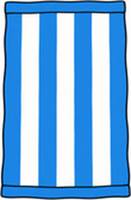

# Unit 1 The Great Outdoors — 第一回｜出遊計畫 Going To

姓名：________　座號：____　分數：____ / 100

## 一、聽力測驗

按「🔊 播放」聽句子（可重複聽），選出正確答案。

1. 🔊（老師播放）What does the speaker have?
   (A) a bat and a mitt　(B) a tennis racket and a ball　(C) a skateboard and a helmet　(D) a fishing rod and a bucket
2. 🔊（老師播放）What is B going to do?
   (A) do homework　(B) eat pizza　(C) play baseball　(D) play tennis
3. 🔊（老師播放）What does B think?
   (A) It will rain.　(B) It's going to snow.　(C) B doesn't know, and hopes it won't rain.　(D) It will be hot.
4. 🔊（老師播放）Where is she going?
   (A) the mountains　(B) the beach　(C) the circus　(D) the park
5. 🔊（老師播放）How's the weather going to be?
   (A) cool　(B) foggy　(C) hot　(D) cold

## 二、是非題

閱讀短文，判斷句子是 True（對）或 False（錯）。

> Tom is going to go camping tomorrow. He's really excited. He has a tent and a sleeping bag, but he doesn't have a flashlight. The weather is going to be cool. It isn't going to rain.

6. Tom is going to go fishing tomorrow.　（ T / F ）
7. Tom has a tent.　（ T / F ）
8. Tom has a flashlight.　（ T / F ）
9. The weather is going to be cool.　（ T / F ）
10. It's going to rain tomorrow.　（ T / F ）

## 三、選擇題

選出最適合的答案。

11. I'm going to go ____. I have a skateboard.
   (A) to skateboarding　(B) skateboarding　(C) skateboard　(D) play skateboard
12. You need a ____ to play tennis.
   (A) flashlight　(B) fishing rod　(C) tennis racket　(D) bucket
13. A: How's the weather going to be?  B: It's going to be ____.
   (A) cold　(B) a hat　(C) Yes, it is.　(D) skateboarding
14. We're going to go camping tomorrow. I'm really ____!
   (A) excited　(B) cool　(C) warm　(D) hot
15. A: Is it going to rain?  B: ____
   (A) I'm not sure.　(B) I'm going to go fishing.　(C) It's a bucket.　(D) He needs a hat.
16. What is this?  這是什麼？
   
   (A) a swimsuit　(B) a towel　(C) a tent　(D) a hat
17. What is this?  這是什麼？
   
   (A) a helmet　(B) a bucket　(C) a towel　(D) a tent

## 四、文法測驗

選出文法正確的答案。

18. She ____ going to play tennis today.
   (A) are　(B) am　(C) be　(D) is
19. What does she ____?  She needs a hat.
   (A) needs　(B) to need　(C) need　(D) needing
20. They ____ helmets.
   (A) need　(B) is need　(C) needs　(D) needing
21. I'm not going ____ study with Sue.
   (A) at　(B) in　(C) to　(D) for
22. ____ he need an umbrella?
   (A) Are　(B) Does　(C) Is　(D) Do

## 五、配合題

左邊的題目要配右邊哪一個？用下拉選單選出代號。

- (A) She needs a hat.
- (B) I hope not.
- (C) I'm going to go skateboarding.
- (D) It's going to be hot.
- (E) No, he doesn't.

23. What are you going to do?　（　）
24. What does she need?　（　）
25. How's the weather going to be?　（　）
26. Is it going to rain?　（　）
27. Does he need an umbrella?　（　）

## 六、句子改寫

依照提示改寫句子，直接輸入完整句子（注意大小寫與標點可忽略）。

28. (改成否定句) I'm going to play tennis with you.
   → ______________________________
29. (改成疑問句) He is going to play tennis with May today.
   → ______________________________
30. (主詞改成 He) I have a bat and a mitt.
   → ______________________________
31. (主詞改成 They，a hat 改成複數) She needs a hat.
   → ______________________________
32. (改成否定句) He needs an umbrella.
   → ______________________________

## 七、句子重組

依序點選單字，排成正確的句子。

33. I'm / going / skateboarding. / go / to
   → ______________________________
34. How's / to / going / the / weather / be?
   → ______________________________
35. hat. / a / She / needs
   → ______________________________
36. with / you. / tennis / play / to / not / I'm / going
   → ______________________________
37. going / with / tennis / Are / you / today? / play / to / me
   → ______________________________

---

## 聽力稿（老師用）

1. I'm going to play baseball. I have a bat and a mitt.
2. A: What are you going to do after school today? B: I'm going to play tennis with Gus.
3. A: Is it going to rain tomorrow? B: I'm not sure. I hope not.
4. She's going to the beach. She needs a towel and sunscreen.
5. A: How's the weather going to be tomorrow? B: It's going to be cold.

## 答案

**一、聽力測驗**　1. A　2. D　3. C　4. B　5. D

**二、是非題**　6. F　7. T　8. F　9. T　10. F

**三、選擇題**　11. B　12. C　13. A　14. A　15. A　16. B　17. D

**四、文法測驗**　18. D　19. C　20. A　21. C　22. B

**五、配合題**　23. C　24. A　25. D　26. B　27. E

**六、句子改寫**　
- 28. I'm not going to play tennis with you.
- 29. Is he going to play tennis with May today?
- 30. He has a bat and a mitt.
- 31. They need hats.
- 32. He doesn't need an umbrella.

**七、句子重組**　
- 33. I'm going to go skateboarding.
- 34. How's the weather going to be?
- 35. She needs a hat.
- 36. I'm not going to play tennis with you.
- 37. Are you going to play tennis with me today?
