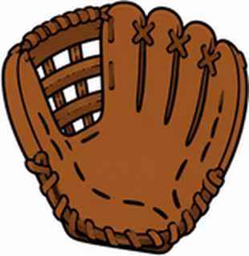
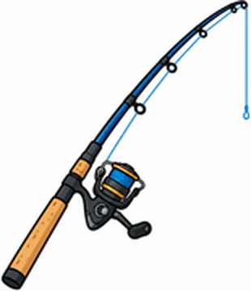

# Unit 1 The Great Outdoors — 第二回｜運動用品 Let's Learn

姓名：________　座號：____　分數：____ / 100

## 一、聽力測驗

按「🔊 播放」聽句子（可重複聽），選出正確答案。

1. 🔊（老師播放）What does he have?
   (A) a tennis ball and a racket　(B) a bat and a mitt　(C) a helmet and a skateboard　(D) a bucket and a fishing rod
2. 🔊（老師播放）What is the speaker going to do?
   (A) go fishing　(B) play baseball　(C) play tennis　(D) go skateboarding
3. 🔊（老師播放）What does B have?
   (A) a skateboard and a helmet　(B) a bat and a mitt　(C) a tent and a flashlight　(D) a racket and a ball
4. 🔊（老師播放）What do they have?
   (A) bats　(B) fishing rods　(C) buckets　(D) tennis rackets
5. 🔊（老師播放）What is B going to do?
   (A) go skateboarding　(B) go fishing　(C) play tennis with A　(D) play video games

## 二、是非題

閱讀短文，判斷句子是 True（對）或 False（錯）。

> Anna and Ben are going to the park after school. Anna is going to go skateboarding. She has a skateboard and a helmet. Ben is going to play baseball. He has a bat, but he doesn't have a mitt. Anna is going to lend him one.

6. Anna is going to play baseball.　（ T / F ）
7. Anna has a helmet.　（ T / F ）
8. Ben has a bat.　（ T / F ）
9. Ben has a mitt.　（ T / F ）
10. They are going to the beach.　（ T / F ）

## 三、選擇題

選出最適合的答案。

11. A mitt is for ____.
   (A) tennis　(B) fishing　(C) baseball　(D) skateboarding
12. What's he going to do?  He's going to ____.
   (A) play baseball　(B) go baseball　(C) playing baseball　(D) plays baseball
13. You need a ____ to catch a fish.
   (A) bat　(B) fishing rod　(C) racket　(D) helmet
14. A helmet protects your ____.
   (A) eye　(B) hand　(C) head　(D) foot
15. He ____ a tennis ball and a tennis racket.
   (A) have　(B) is　(C) are　(D) has
16. What is this?  這是什麼？
   
   (A) a bat　(B) a bucket　(C) a mitt　(D) a helmet
17. What is this?  這是什麼？
   
   (A) a skateboard　(B) a fishing rod　(C) a tennis racket　(D) a bat

## 四、文法測驗

選出文法正確的答案。

18. I ____ going to go fishing.
   (A) is　(B) be　(C) am　(D) are
19. What ____ you going to do?
   (A) is　(B) am　(C) are　(D) does
20. He ____ a bat and a mitt.
   (A) do　(B) has　(C) are　(D) have
21. ___ you going to play tennis with Gus?
   (A) Am　(B) Is　(C) Does　(D) Are
22. I'm going to go ____ after school.
   (A) skateboarding　(B) skateboards　(C) skateboard　(D) to skateboard

## 五、配合題

左邊的題目要配右邊哪一個？用下拉選單選出代號。

- (A) 釣竿
- (B) 安全帽
- (C) 球棒
- (D) 水桶
- (E) 棒球手套

23. a mitt　（　）
24. a bat　（　）
25. a helmet　（　）
26. a fishing rod　（　）
27. a bucket　（　）

## 六、句子改寫

依照提示改寫句子，直接輸入完整句子（注意大小寫與標點可忽略）。

28. (改成疑問句) You are going to play tennis today.
   → ______________________________
29. (改成否定句) I'm going to go skateboarding.
   → ______________________________
30. (主詞改成 She) I have a skateboard and a helmet.
   → ______________________________
31. (改成疑問句) He has a bat.
   → ______________________________
32. (改成否定句) We're going to play baseball.
   → ______________________________

## 七、句子重組

依序點選單字，排成正確的句子。

33. What / do? / to / are / you / going
   → ______________________________
34. play / to / going / baseball. / He's
   → ______________________________
35. has / bat / and / He / a / mitt. / a
   → ______________________________
36. going / go / to / fishing. / I'm
   → ______________________________
37. and / a / I / have / skateboard / helmet. / a
   → ______________________________

---

## 聽力稿（老師用）

1. A: What's he going to do? B: He's going to play baseball. He has a bat and a mitt.
2. I'm going to go fishing. I have a fishing rod and a bucket.
3. A: What are you going to do? B: I'm going to go skateboarding. I have a skateboard and a helmet.
4. They're going to play tennis. They have tennis rackets.
5. A: Are you going to play tennis with me today? B: No, I'm not. I'm going to play video games with my brother.

## 答案

**一、聽力測驗**　1. B　2. A　3. A　4. D　5. D

**二、是非題**　6. F　7. T　8. T　9. F　10. F

**三、選擇題**　11. C　12. A　13. B　14. C　15. D　16. C　17. B

**四、文法測驗**　18. C　19. C　20. B　21. D　22. A

**五、配合題**　23. E　24. C　25. B　26. A　27. D

**六、句子改寫**　
- 28. Are you going to play tennis today?
- 29. I'm not going to go skateboarding.
- 30. She has a skateboard and a helmet.
- 31. Does he have a bat?
- 32. We're not going to play baseball.

**七、句子重組**　
- 33. What are you going to do?
- 34. He's going to play baseball.
- 35. He has a bat and a mitt.
- 36. I'm going to go fishing.
- 37. I have a skateboard and a helmet.
